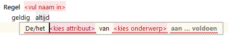
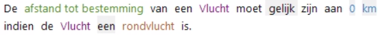
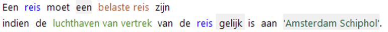
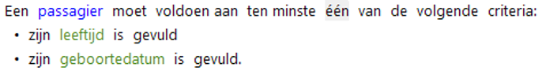
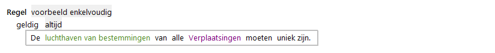
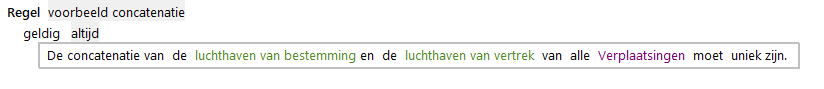
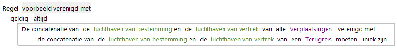

# Consistentieregel

De ConsistentieRegel is de actie voor het specificeren van een regel om te controleren of gegevens een juiste/geldige waarde hebben.

Consistentiecontroles worden uitgevoerd op invoerwaarden en worden gebruikt voor acceptatieservices.

Opties voor het opgeven van criteria waarop gecontroleerd moet worden:

* attribuut moet aan criterium voldoen.
* rol of expressie moet aan criterium voldoen.

## variant: attribuut moet aan criterium voldoen

Het resultaatdeel van de regel met een consistentiecontrole voor een attribuut ziet er als volgt uit:

Ook bij deze actie geldt dat een voorwaardendeel kan worden opgenomen waarin wordt bepaald 
wanneer de actie (consistentiecontrole) moet worden uitgevoerd.

## variant: rol of expressie moet aan criterium voldoen

Actie waarmee diverse soorten consistentiecontroles op objecten en rollen kunnen worden geformuleerd. 

Bijvoorbeeld:

een controle of voorkomens met een bepaalde rol of kenmerk aan een enkelvoudig criterium voldoen.

of

een controle van voorkomens met een bepaalde rol of kenmerk aan meerdere criteria voldoen.

## Uniciteit met en zonder concatenatie

In RegelSpraak wordt ervan uitgegaan dat de verschillende instanties van een objecttype ook verschillende objecten in de realiteit weergeven.
Uniciteitschecks zijn alleen nodig als dat niet het geval is. De objecten zijn dan eerdere representaties van (of gegevens over) deze werkelijke objecten in verschillende contexten.
Om dan te kunnen achterhalen dat twee representaties over hetzelfde werkelijke object gaan is er een identificerend attribuut nodig waarvan de uniciteit per werkelijk object gewaarborgd wordt.
Daar bestaat meestal een identificerend nummer voor in een veld met Datatype *numeriek* of *tekst*. Daar kan deze controle over worden uitgevoerd.
Daarvoor is het speciale predicaat is **uniek zijn**.
Met dit predicaat kan voor één of een combinatie van attributen gecontroleerd worden of deze over de instanties heen dezelfde waarde hebben.
Dit noemen we *uniciteit*. Dit predicaat is *waar* als Is de waarde van een attribuut of combinatie van attributen uniek over instanties heen.
Dit predicaat kan alleen gebruikt worden in [consistentieregels](Actie_Consistentieregel.md), en alleen in een enkel criterium (dus niet in een samengesteld criterium).
De attributen waarvan de waardes worden vergeleken moeten hierbij gespecificeerd worden.

Uniciteit kan verder ook gecontroleerd worden voor een combinatie van attributen.
Er wordt dan gecontroleerd of de combinatie van de attribuutwaarden uniek is.
Een consistentieregel met twee of meer attributen schrijven we door een concatenatie van deze twee attributen te specificeren. (Zet in de expressie eerst **concatenatie**)

Dit doen we door een vereniging te specificeren van de twee attributen. (Druk op ENTER aan het einde van **van** in de expressie.)
Let wel: een vereniging is de combinatie van twee attributen met hetzelfde datatype.
Het resultaat hiervan is een verzameling die bestaat uit de waarden van naam voor alle instanties van beide objecttypen.

Tenslotte kan de uniciteit gecontroleerd worden voor een combinatie van twee attributen van twee objecttypen. We kunnen dan bijvoorbeeld controleren of er geen figuren zijn met dezelfde combinatie van naam en kleur. We specificeren dan twee concatenaties van deze attributen voor beide objecttypen die we gebruiken voor de vereniging waarvoor vervolgens de uniciteit bepaald moet worden:

