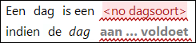
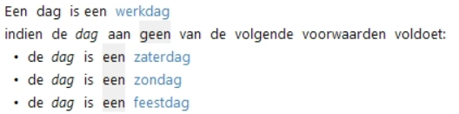
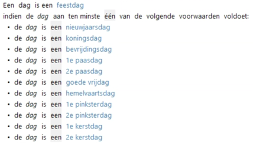
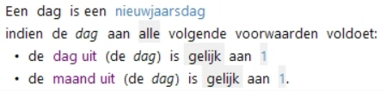

# Dagsoortdefinitie

Een dagsoortdefinitie wordt gebruikt om te defini�ren wanneer een dag van een bepaalde een specifieke [dagsoort](../gegevens/dagsoort.md) is.
Een voorbeeld hierbij kan zijn om te bepalen of een dag een Kerstdag is.

## Voorbeeld: dagsoorten werkdag, feestdag en nieuwjaarsdag

## Dagsoortdefinitie testen

Of een dagsoortdefinitie de juiste dagen oplevert, kan direct in een testgeval getest worden.
Per datum wordt dan voorspeld of die wel of niet van de dagsoort is, bijvoorbeeld **5-5-2021 is een feestdag**.
Zie [Dagsoorten testen](../testen/Testset.md#dagsoorten-testen).
