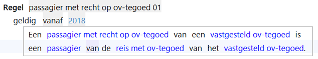
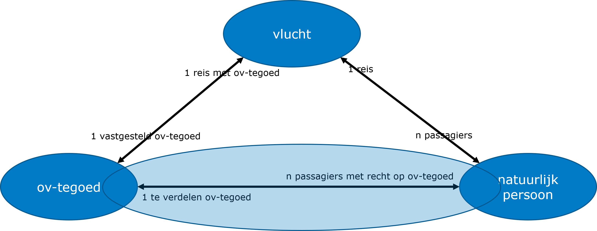
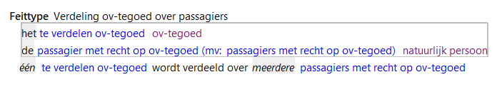

# Feitcreatie

Feitcreatie is de Actie waarmee afgeleide relaties worden bepaald.
De afgeleide relatie moet wel via een [feittype](../gegevens/feittype.md) dat al in het objectmodel staat.

Deze regel legt een relatie tussen een ov-tegoed en een natuurlijk persoon en gebruikt daarin de rollen uit het feittype 'Verdeling ov-tegoed over passagiers'.

Met de regel in het voorbeeld wordt vastgelegd dat de instanties voor passagier, vlucht en de waarden van OV-tegoed allemaal bij elkaar horen.

De Actie [Objectcreatie](Actie_Objectcreatie.md) wordt gebruikt voor modellen met objecten met afgeleide gegevens die via rollen zijn verbonden aan andere instanties die direct gevuld worden met waarden.
In het voorbeeld voor objectcreatie was dat het OV-tegoed, dat aan de vlucht werd gekoppeld.
De Actie Feitcreatie is vervolgens nodig om de relatie van de met regels gecreeerde instanties met andere objecten te definieren.
Pas daarna heeft de instantie van OV-tegoed een directe link met de persoon die passagier was op de vlucht.
