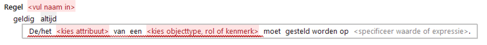

# Gelijkstelling

De Gelijkstelling is een actie waarbij een attribuut van een bepaald object een waarde krijgt.
Dat kan via een berekening, dan ziet het taalpatroon er iets anders uit.

Achter "specificeer waarde of expressie" kan worden gekozen uit een groot aantal [expressies](Expressies.md) waarmee de gewenste formulering van de regel verder kan worden opgebouwd.
Als de gelijkstelling alleen verwijst naar een ander attribuut, dan leest de zin: **... moet gesteld worden op ...**

De linker- en de rechterkant van een gelijkstelling moeten hetzelfde datatype hebben, en indien er verschillende eenheden worden gebruikt dan moeten deze in elkaar om te rekenen zijn via een eenheidssysteem.
Wanneer gelijkgesteld wordt aan een lege waarde zal het resultaat altijd een lege waarde zijn.