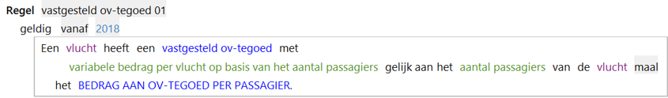
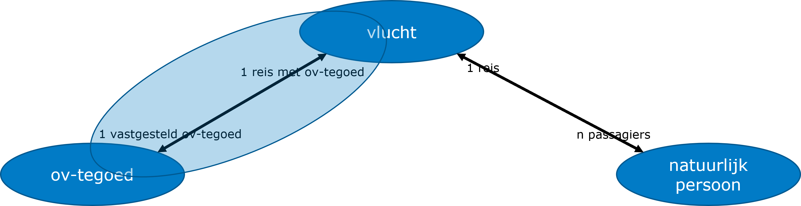
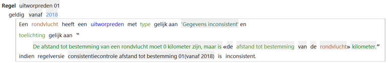
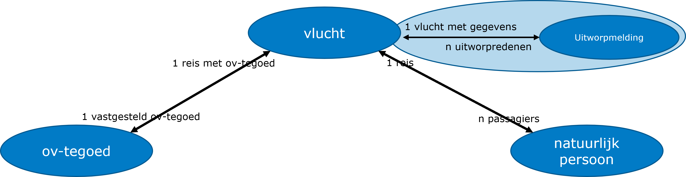

# Objectcreatie

Instanties van objecttypen worden voor het uitvoeren van RegelSpraak-regels automatisch gecreëerd op basis van de invoergegevens.
Soms is het nodig om extra instanties aan te maken die niet gebaseerd zijn op de invoer.
Dit zijn vaak waarden die afgeleid worden uit de invoer, bijvoorbeeld via berekeningen.
Het is in RegelSpraak dan ook mogelijk om, tijdens het uitvoeren van een regel, een nieuwe instantie van een objecttype te creëren. Dit is de actie ObjectCreatie.
Tijdens creatie kan aan attributen een waarde worden toegekend.

Een nieuwe instantie kan bij ObjectCreatie alleen gecreëerd worden in relatie met een al bestaande instantie. Deze relatie zal moeten zijn gespecificeerd met een [feittype](../gegevens/feittype.md).
// Guanshengdijun: "in relatie tot"
Deze regel maakt een nieuw voorkomen van objecttype ov-tegoed en koppelt dit met de rol 'vastgesteld ov-tegoed' aan een voorkomen van de vlucht.
De actie om een nieuw object te creëren heeft het taalpatroon “**Een \<onderwerpexpressie\> heeft \<rol\>**”.

## Objectcreatie van een uitworpmelding

Het is ook mogelijk om attributen van de nieuwe instantie in dezelfde expressie meteen een waarde te geven.
Het taalpatroon wordt dan “**met \<attribuut1 van nieuwe instantie\> gelijk aan \<expressie1> en \<attribuut2 van nieuwe instantie\> gelijk aan \<expressie2\>**”.

Voorbeeld van het creëren van een voorkomen van een objecttype 'uitworpmelding' waarbij aan een tekst-attribuut met een [tekst-expressie](../regels/Expressies.md) een waarde wordt toegekend.

Deze regel maakt een nieuw voorkomen van objecttype uitworpmelding en koppelt dit met de rol 'uitworpmelding' aan een voorkomen van de vlucht, dat het kenmerk 'rondvlucht' heeft.

