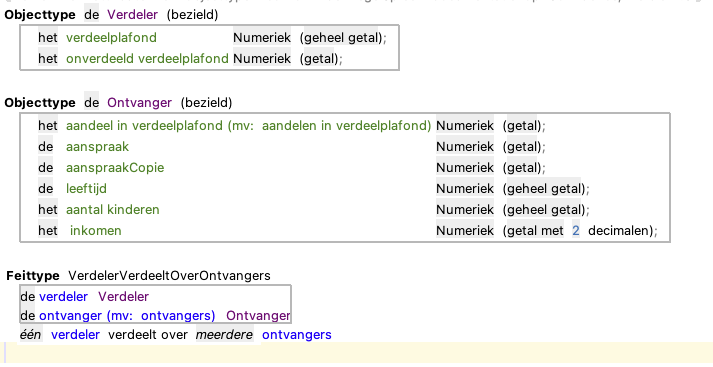
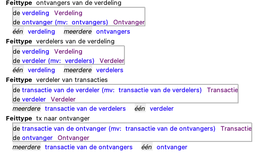
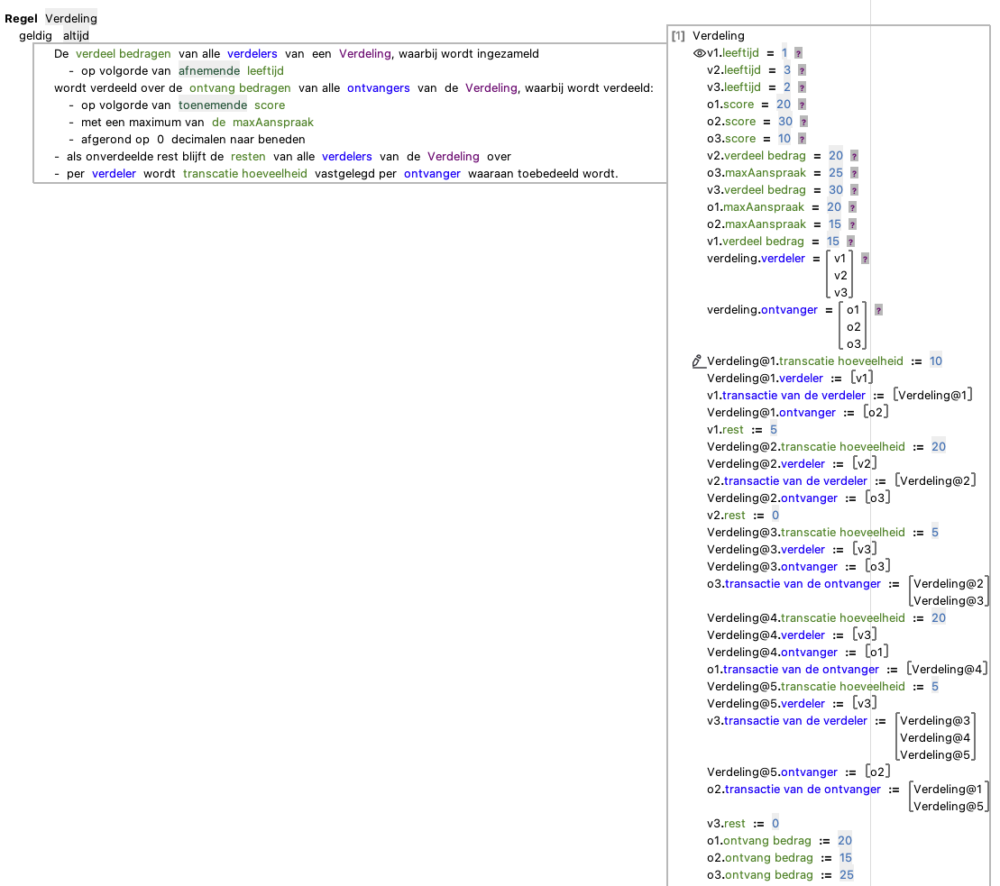
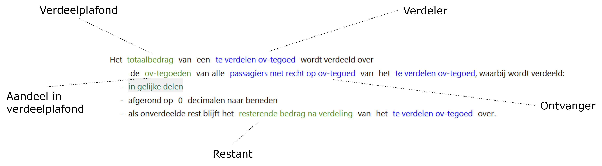
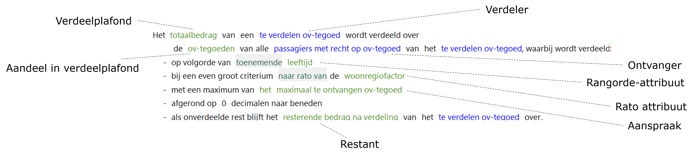
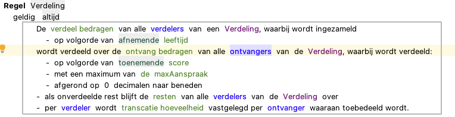

# Verdeling

Een *verdeling* wordt gebruikt om een waarde van een numeriek attribuut (ook wel het *verdeelplafond* genoemd) te verdelen over attribuutwaarden van *andere* objecten (ook wel het *aandeel in een verdeelplafond* genoemd) waartussen een meervoudig [feittype](../gegevens/feittype.md) is gedefinieerd.
In een verdeling wordt gesproken over een *verdeler* en een *ontvanger*. De verdeler is de rol met het attribuut waarvan de waarde (het verdeelplafond) wordt verdeeld en de ontvanger is de rol met het attribuut waaraan een deel van de waarde (het aandeel in het verdeelplafond) wordt toegekend.
Als niet het hele verdeelplafond wordt toegerekend aan ontvangers (door afronding of aanspraak) dan wordt een restant berekend voor iedere Verdeler.

Een verdeling kan met of zonder subgroepen:
// Guanshengdijun: Ik mis na "kan" nog een twee werkwoord, iets als "kan plaatsvinden"

* **Verdelen vanuit één of meerdere verdelers**  
Verdelingen vanuit meerdere verdelers met verdeelplafonds en restanten. Kan gebruikt worden via de intentie “Verdeel Vanuit Meerdere Verdelers” beschikbaar op de verdeling. Verdelers en ontvangers bieden de volgende optie.
  // Guanshengdijun: Ik begrijp niet wat de laatste zin inhoudt. Houdt de verdeling met subgroepen verband met bovenstaande regel?
* **Verdeling met subgroepen**
Dit houdt in dat Ontvangers in subgroepen worden ingedeeld, waarover in een volgorde wordt verdeeld.

Dit zijn de opties binnen de toepassing van de actie verdeling:

* **Verdeling over alle ontvangers**
  * Gelijke verdeling
  * Naar rato
* **Verdeling over groepen ontvangers in een volgorde**
* **Gebruik van een maximale aanpak**
* **Gebruik van afronding**
* **Gebruik van onverdeelde rest**

## Verdeling over alle ontvangers

Bij een verdeling wordt altijd vastgelegd of er *gelijk verdeeld* moet worden of *naar rato* van de waarde van een ander attribuut waarbij dit altijd een attribuut van de ontvanger is.

## Relatiemodel voor één of meerdere verdelers

Een enkele verdeler verdeelt over zijn ontvangers. De relatie is één op meer.

Bij meerdere verdelers heeft een verdeling zijn (één op meer) verdelers en (één op meer) ontvangers. Een transactieobject heeft een (aparte) relatie met de verdeler en ontvanger
// Guanshengdijun: Is "zijn" hier een werkwoord of een bezittelijk voornaamwoord? In het eerste geval kan die weg. Er mist aan het eind van de regel ook een punt.

### Gelijk verdelen

Gelijk verdelen is op basis van het aandeel van een ontvanger gedeeld door het totale aandeel van de ontvangers in de groep. Bijvoorbeeld 1/3 voor 1 ontvanger binnen een groep van 3.

### Naar rato

Wanneer naar rato wordt verdeeld krijgen de instanties van de rol met een hogere waarde voor dit 'naar rato attribuut' een groter aandeel van het te verdelen bedrag dan instanties met een kleinere waarde.
In het voorbeeld onderaan wordt het numerieke attribuut 'woonregiofactor' gebruikt. Stel dat we 1000 miles moeten verdelen over Tom en maria. Die van Tom is 3 en die van Maria 2, dus samen 5. Dat betekent dat Tom 3/5e deel van de 1000 beschikbare treinmiles krijgt, dus 600 treinmiles. Maria krijgt 2/5e deel, dus 400 treinmiles.
// Guanshengdijun: Ik neem aan dat je in het voorbeeld met "die van Tom" verwijst naar de woonregiofactor, maar dat staat twee zinnen verderop. Ik zou hier expliciet noemen dat het daarover gaat.

## Verdeling over groepen ontvangers in een volgorde

Binnen een verdeling kan een groepering van de ontvangers gespecificeerd worden op basis van een attribuut van de ontvangers.
Hierbij specificeer je ook altijd of je afnemend of toenemend wil verdelen op basis van dit attribuut.
Met een verdeling over groepen kun je bijvoorbeeld passagiers met een lagere leeftijd een grotere hoeveelheid treinmiles toekennen dan passagiers met een hogere leeftijd.

Zodra verdeeld wordt over groepen moet ook iets gespecificeerd worden over wat er gebeurt wanneer er meerdere instanties zijn die in dezelfde groep vallen (meerdere passagier met dezelfde leeftijd bijvoorbeeld).
Hierbij bestaat opnieuw de mogelijkheid om dit in [gelijke delen](#gelijk-verdelen) te doen of [naar rato](#naar-rato) op basis van een attribuut van de ontvanger.

## Gebruik van een maximale aanspraak

Als naar rato wordt verdeeld kan bij beide bovengenoemde vormen van verdeling een zogenaamde aanspraak toegevoegd worden.
// Guanshengdijun: Hieronder herhalend: het is belangrijk om "maximum" bij "aanspraak" te noemen. Elke ontvanger heeft aanspraak, maar wat dit aangeeft is dat er aan die aanspraak een limiet zit.
Dit is niet mogelijk bij gelijke verdeling omdat een gelijke verdeling met een maximum aanspraak voor meerdere uitleg vatbaar is.
// Guanshengdijun: "meerdere uitleg" klopt niet, maar ik kan ook niet echt zien wat je bedoelt, dus ik kan ook niet echt een alternatieve suggestie doen.
Deze aanspraak is altijd een numeriek attribuut van de ontvanger en beschrijft hoeveel een individuele ontvanger maximaal kan krijgen uit de verdeling.
Dit is belangrijk om te gebruiken in combinatie met het verdelen over groepen. Want zonder maximum zou het hele te verdelen bedrag over de eerste groep verdeeld worden.
Als een maximale aanspraak wordt gespecificeerd, dan moet ook altijd een [onverdeelde rest](#gebruik-van-onverdeelde-rest) worden gespecificeerd omdat door toepassing van het maximum het totale verdeelplafond mogelijk niet helemaal wordt toegewezen.

## Gebruik van afronding

Als laatste kan het te ontvangen aantal treinmiles ook afgerond worden. Dit kan in deze situatie alleen naar beneden maar er kan wel een aantal decimalen gespecificeerd worden.
// Guanshengdijun: Er mist een komma tussen "beneden" en "maar"
Als wordt afgerond, dan moet ook altijd een onverdeelde rest worden gespecificeerd omdat door toepassing van de afronding het totale verdeelplafond mogelijk niet helemaal wordt toegewezen.

## Gebruik van onverdeelde rest

In het geval van verdelen met een aanspraak of een afronding kan het voorkomen dat na het verdelen een restant waarde overblijft. Deze waarde *moet* worden vastgelegd in een attribuut van de verdeler.

## Omgang met lege waarden

Onderstaande tabel bevat het overzicht van de resultaten van de verdeling als één van de attributen een lege of uitzonderlijke waarde heeft.
// Guanshengdijun: Hier mist volgens mij de genoemde tabel

## Transacties

Een Verdeling die verdeelt vanuit meerdere verdelers heeft ook de optie om transacties toe te voegen via de intentie ***voeg transacties toe***. Dit zijn objecten die gecreëerd worden tijdens de verdeling waarin bekeken kan worden hoeveel een verdeler heeft verdeeld naar een ontvanger. Transacties zijn niet beschikbaar als de verdeling verdeelt vanuit een enkele verdeler.

## Voorbeelden

### Voorbeeld 1: Verdeling zonder groepen

In dit geval wordt de hoeveelheid die door de Verdeler verdeeld wordt (verdeelplafond) in gelijke delen toegewezen aan de Ontvangers (aandeel in verdeelplafond).

### Voorbeeld 2: Verdeling met groepen

In dit geval wordt de hoeveelheid die door de Verdeler verdeeld wordt (verdeelplafond) toegewezen aan de Ontvangers (aandeel in verdeelplafond) op basis van een groepering die wordt bepaald door een attribuut. De Ontvangers met dezelfde waarde voor dat attribuut (bijvoorbeeld 'leeftijd') worden in subgroepen opgedeeld en de verdeling vindt dan plaats over die subgroepen in een volgorde.

De aanspraak die een Ontvanger kan hebben wordt bepaald door het aanspraak-attribuut en bepaalt het maximale aandeel in het verdeelplafond voor de Ontvanger. Tenslotte wordt door een rato-attribuut bepaald wat de verdeling moet zijn bij een gelijk criterium.

### Voorbeeld 3: Verdeling met meerdere verdelers

In dit geval wordt de hoeveelheid die door de Verdelers verdeeld wordt toegewezen aan de Ontvangers. Ieder deel wordt vastgelegd in een transactie object

