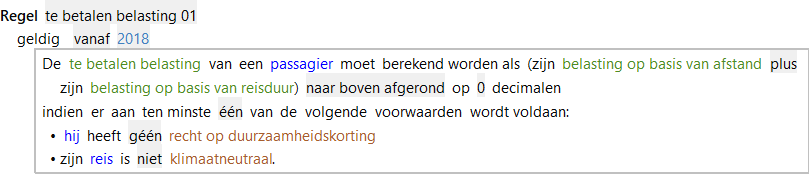

# Acties

Dit zijn uitdrukkingen waarmee de actie in het [resultaatdeel](OpbouwRegelSpraakRegel.md) wordt geformuleerd.
Het resultaatdeel van een regel is verplicht.

In onderstaande regel is de actie 'moet berekend worden als' (Gelijkstelling). In het actiedeel staat een numerieke [expressie](../regels/Expressies.md) 'belasting op basis van afstand plus belasting op basis van reisduur'.

In het resultaatdeel van een RegelSpraak regel kunnen de volgende acties worden gebruikt:

* [ConsistentieRegel](../regels/Actie_Consistentieregel.md)
De ConsistentieRegel is de actie voor het specificeren van een regel om te controleren of gegevens een juiste/geldige waarde hebben.
* [Dagsoortdefinitie](../regels/Actie_Dagsoortdefinitie.md)
De Dagsoortdefinitie is de actie waarmee een specifieke dagsoort wordt gedefinieerd.
* [Feitcreatie](../regels/Actie_Feitcreatie.md)
Feitcreatie is de actie waarmee afgeleide relaties worden bepaald.
* [Gelijkstelling](../regels/Actie_Gelijkstelling.md)
De Gelijkstelling is een actie waarbij voor een attribuut van een bepaald object een waarde wordt afgeleid.
* [Initialisatie](../regels/Actie_Initialisatie.md)
De Initialisatie is een specifieke variant van de actie [Gelijkstelling](../regels/Actie_Gelijkstelling.md).
* [Kenmerktoekenning](../regels/Actie_Kenmerktoekenning.md)
De Kenmerktoekenning is de actie voor het toekennen van een kenmerk aan een object of rol.
* [Objectcreatie](../regels/Actie_Objectcreatie.md)
De objectcreatie is de actie waarmee een voorkomen van een object wordt gecreëerd.
* [Verdeling](../regels/Actie_Verdeling.md)
Verdeling is de actie voor het verdelen van een te verdelen hoeveelheid over een aantal Ontvangers.

## Recursie

Bij toepassing van een [gelijkstelling](Actie_Gelijkstelling.md), [kenmerktoekenning](Actie_Kenmerktoekenning.md), [feitcreatie](Actie_Feitcreatie.md) en [objectcreatie](./Actie_Objectcreatie.md) is een *cyclische* specificatie niet toegestaan. Dat wil zeggen dat een eigenschap (rol, kenmerk of attribuut) van een instantie van een objecttype wordt afgeleid van dezelfde eigenschap van *dezelfde* instantie van het objecttype.
Wel zijn binnen specifieke regelgroepen recursie toegestaan.
Recursie houdt in dat een eigenschap van een instantie van een objecttype wordt afgeleid van dezelfde eigenschap van een *andere* instantie van het objecttype.

Het onderscheid tussen een echt cyclische en een recursieve specificatie is echter niet betrouwbaar geautomatiseerd te bepalen. Daarom worden regels die cyclisch zijn of lijken in principe afgekeurd.
Recursie in Regelspraak moet daarom aan een aantal voorwaarden voldoen.
De moeten de regels in een regelgroep worden gegroepeerd en die regelgroep moet als recursief worden gekenmerkt.
// Guanshengdijun: Ik vermoed dat "De" "Dan" had moeten zijn
In die regelgroep worden de regels opgenomen die worden toegepast op instanties van objecttypes die in de regelgroep worden gecreëerd.
Deze regels maken gebruik van resultaten van dezelfde regels die zijn toegepast op de voorgaande instantie van het objecttype.
De regels in de regelgroep worden herhaaldelijk uitgevoerd, maar eindeloze herhaling wordt voorkomen door de voorwaarden die worden gesteld aan de objectcreatieregel.

Dit betekent dat een recursieve regelgroep moet voldoen aan de volgende voorwaarden:

* De regelgroep bevat een [objectcreatieactie](Actie_Objectcreatie.md).
* De objectcreatieregel bevat een [voorwaarde](Voorwaardendeel.md) met betrekking tot een maximale of minimale waarde van de af te leiden waarde waarboven c.q. waaronder de regel niet meer wordt uitgevoerd.
* De objectcreatieregel bevat een voorwaarde met betrekking tot het maximale aantal iteraties waarboven de regel niet meer wordt uitgevoerd.

Een recursieve regelgroep kan bijvoorbeeld worden gebruikt voor het afleiden van een bruto bedrag als het netto bedrag en het percentage dat op het te berekenen bruto bedrag moet worden ingehouden, vaststaan.
