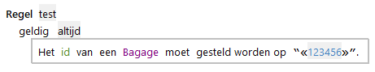
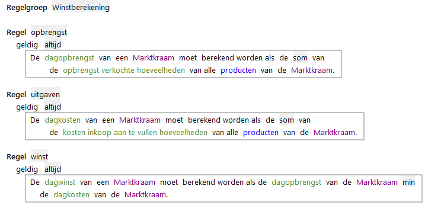

# Expressies

Een expressie is een RegelSpraak uitdrukking die één waarde of een lijst van waardes oplevert van een bepaald type. Daarbij kan dat type een [datatype](../gegevens/datatype.md) zijn,  maar ook een [objecttype](../gegevens/objecttype.md).
In [RegelSpraak](OpbouwRegelSpraakRegel.md) worden *expressies* gebruikt in het resultaatdeel, voorwaardendeel én het variabelendeel.
Meerdere expressies worden met elkaar gecombineerd in deze delen om de logica van de regel uit te drukken in zijn volledigheid.
Een expressie die één waarde oplevert wordt een enkelvoudige expressie genoemd en een expressie die een lijst van waardes oplevert wordt een meervoudige expressie genoemd.
Vaak specificeren we expressies ook met het type dat het oplevert. Een expressie die een enkele numerieke waarde oplevert noemen we bijvoorbeeld een enkelvoudige numerieke expressie.

ALEF biedt de volgende soorten expressies:

* Literal expressies
* Tekst expressies
* Numerieke expressies (kan ook met eenheden van tijd)
* [Datum-tijd expressies](Expressies_Datum.md)
* [Onderwerpexpressies](Expressies_Selectie.md)
* [Subselectie expressies](Expressies_Selectie.md)
* [Aggregratie expressies](Expressies_Selectie.md)
* [Concatenatie expressies](Expressies_Selectie.md)

## Literal Expressies

Een *literal expressie* bevat alleen een enkele waarde met eventueel een eenheid.
Het is de formele term voor het direct gebruik van een waarde in RegelSpraak.
N.B: als de waarde van het datatype *Tekst* is, dan moet de waarde zelf tussen dubbele aanhalingstekens (“*waarde*”) staan.
Dit geldt niet voor waarden in een enumeratie.
Deze worden uitgedrukt met enkele aanhalingstekens wanneer ze in een regel aangehaald worden ('*waarde*').

## Tekst expressies

In expressies, die een waarde van het datatype Tekst opleveren, kan gebruik worden gemaakt van de expressie **reeks van teksten en waarden**.
Dit is een expressie die gebruikt wordt om bij uitvoering van de regel de waarden van een expressie om te zetten naar een tekstwaarde, ook als de attributen een ander datatype hebben dan “Tekst”. Attributen in een reeks van teksten en waarden worden in dat geval omringd door “«»” haken.

## Datum-tijd expressies

Datum-tijd expressies gaan over rekenen met tijdseenheden. Dat betekent iets anders dan [tijdsafhankelijke expressies](#tijdsafhankelijke-expressies). Meerdere soorten expressies kunnen tijdsafhankelijk zijn.

## Tijdsafhankelijke expressies

In een expressie kunnen attributen, parameters of kenmerken gebruikt worden die [tijdsafhankelijk](../gegevens/tijdlijn.md) zijn.
Dit zijn attributen, parameters en kenmerken waarvoor een die in de tijd verschillende waarden kunnen hebben.
De meeste expressies die hierboven zijn genoemd kunnen wel of niet tijdsafhankelijk zijn.
Als dit wel het geval is, dan is het resultaat van de expressie afhankelijk van de specifieke periode. De enige uitzondering is een specifieke tijdsafhankelijke aggegratie.
Punten op de tijdlijnen waarop de waarde kan veranderen noemen we *knips*.
Dit zijn geen velden die ingevuld moeten worden in RegelSpraak, maar een concept waarmee gevisualiseerd wordt hoe de uitkomst van tijdsafhankelijke expressies verandert met de tijd.
Als het resultaat van de expressie knips op elke dag dag kan bevatten, dan kan de [tijdlijn](../gegevens/tijdlijn.md) van het afgeleide attribuut geen tijdlijn voor elke maand zijn, maar moet er ook een tijdlijn voor elke dag zijn.
Merk dus op dat de granulariteit van perioden van een resultaat dus afhangt van de kleinste van de invoerwaarden.

Een voorbeeld hiervan is een berekening van de nette winst in een winkel. De vaste lasten worden per maand betaald en kunnen maar één keer per maand veranderen. De winst kan elke dag verschillen, maar kan ook meerdere opeenvolgende dagen hetzelfde zijn. RegelSpraak doet het omrekenen automatisch, maar de granulariteit is niet zichtbaar in de regels. Die wordt in [GegevensSpraak](../gegevens/objecttype.md) gedefinieerd.

### Perioden in expressies

De waarden van tijdsafhankelijke attributen, parameters of kenmerken hebben een periode waarin ze van toepassing zijn. Die periode kan als volgt worden gespecificeerd in RegelSpraak:

* Vanaf ...
* Tot en met ...
* Tot ...
* Van ... tot en met ...
* Van ... tot ...

### Rekendatum en Rekenjaar

Zodra een berekening met tidjsafhankelijke expressies uitgevoerd wordt, is er sprake van een Rekendatum of Rekenjaar. Dat is het tijdstip, datum of het jaar op de tijdlijn dat voor die berekening gehanteerd wordt.
Dit is geen veld of expressie in RegelSpraak, maar bepaalt wel de regelversie en periode van tijdsafhankelijke waarden die uitgevoerd worden.