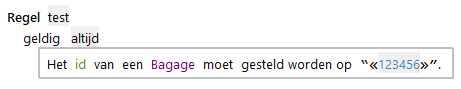
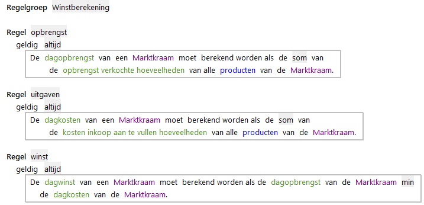
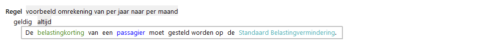
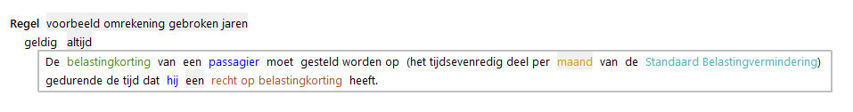

# Expressies

Een expressie is een RegelSpraak uitdrukking die ��n waarde of een lijst van waardes oplevert van een bepaald type. Daarbij kan dat type een [datatype](../gegevens/datatype.md) zijn,  maar ook een [objecttype](../gegevens/objecttype.md).
In [RegelSpraak](OpbouwRegelSpraakRegel.md) worden *expressies* gebruikt in het resultaatdeel, voorwaardendeel �n het variabelendeel.
Meerdere expressies worden met elkaar gecombineerd in deze delen om de logica van de regel uit te drukken in zijn volledigheid.
Een expressie die ��n waarde oplevert wordt een enkelvoudige expressie genoemd en een expressie die een lijst van waardes oplevert wordt een meervoudige expressie genoemd.
Vaak specificeren we expressies ook met het type dat het oplevert. Een expressie die een enkele numerieke waarde oplevert noemen we bijvoorbeeld een enkelvoudige numerieke expressie.

ALEF biedt de volgende soorten expressies:

* Literal expressies
* Tekst expressies
* Numerieke expressies (kan ook met eenheden van tijd)
// Guanshengdijun: Ik zou "van tijd" weghalen, je kan hier ook andere eenheden aan toevoegen. Of begrijp ik verkeerd wat je bedoelt met Numerieke Expressies? Het lijkt te overlappen met Literals en Aggregaties
* [Datum-tijd expressies](Expressies_Datum.md)
* [Onderwerpexpressies](Expressies_Selectie.md)
* [Subselectie expressies](Expressies_Selectie.md)
* [Aggregratie expressies](Expressies_Selectie.md)
* [Concatenatie expressies](Expressies_Selectie.md)

## Literal Expressies

Een *literal expressie* bevat alleen een enkele waarde met eventueel een eenheid.
Het is de formele term voor het direct gebruik van een waarde in RegelSpraak.
N.B: als de waarde van het datatype *Tekst* is, dan moet de waarde zelf tussen dubbele aanhalingstekens (�*waarde*�) staan.
Dit geldt niet voor waarden in een enumeratie.
Deze worden uitgedrukt met enkele aanhalingstekens wanneer ze in een regel aangehaald worden ('*waarde*').

## Tekst expressies

In expressies, die een waarde van het datatype Tekst opleveren, kan gebruik worden gemaakt van de expressie **reeks van teksten en waarden**.
Dit is een expressie die gebruikt wordt om bij uitvoering van de regel de waarden van een expressie om te zetten naar een tekstwaarde, ook als de attributen een ander datatype hebben dan �Tekst�.
Attributen in een reeks van teksten en waarden worden in dat geval omringd door ���� haken.

## Datum-tijd expressies

[Datum-tijd expressies](Expressies_Datum.md) gaan over rekenen met tijdseenheden. Dat betekent iets anders dan [tijdsafhankelijke expressies](#tijdsafhankelijke-expressies).

## Tijdsafhankelijke expressies

In een expressie kunnen attributen, parameters of kenmerken gebruikt worden die [tijdsafhankelijk](../gegevens/tijdlijn.md) zijn.
Dit zijn attributen, parameters en kenmerken waarvoor een die in de tijd verschillende waarden kunnen hebben.
// Guanshengdijun: "waarvoor een" kan hier weg
De meeste expressies die hierboven zijn genoemd kunnen wel of niet tijdsafhankelijk zijn.
Als dit wel het geval is, dan is het resultaat van de expressie afhankelijk van de specifieke periode. De enige uitzondering is een specifieke tijdsafhankelijke aggegratie.
// Guanshengdijun: ik zou het eerste "specifieke" vervangen door "gespecificeerde"
Punten op de tijdlijnen waarop de waarde kan veranderen noemen we *knips*.
// Guanshengdijun: Moet tijdlijnen hier meervoud zijn? Ik ben niet heel erg bekend met tijdsafhankelijke expressies, spreken die doorgaans over één of meerdere tijdlijnen?
Dit zijn geen velden die ingevuld moeten worden in RegelSpraak, maar een concept waarmee gevisualiseerd wordt hoe de uitkomst van tijdsafhankelijke expressies verandert met de tijd.
Als het resultaat van de expressie knips op elke dag dag kan bevatten, dan kan de [tijdlijn](../gegevens/tijdlijn.md) van het afgeleide attribuut geen tijdlijn voor elke maand zijn, maar moet er ook een tijdlijn voor elke dag zijn.
// Guanshengdijun: Ik begrijp de strekking van "dag dag kan bevatten" niet helemaal. In ieder geval zou ik het tweede "dag" tussen aanhalingstekens zetten omdat ik vermoed dat dat naar een waarde verwijst, waar het eerste dag beter in de rest van de zin past. Wederom de vraag of er een tijdlijn voor maand en dag tegelijk kunnen zijn, vanwege het "ook" in de laatste zin. Als dat wel zo is, dan zou ik in plaats van "geen tijdlijn voor elke maand" "niet alleen een tijdlijn voor elke maand" zetten.
Merk dus op dat de granulariteit van perioden van een resultaat dus afhangt van de kleinste van de invoerwaarden.
// Guanshengdijun: In termen van granulariteiten spreken we meestal over "grof" en "fijn" in plaats van "groot" en "klein". Ik zou ook in plaats van "granulariteit van perioden van een resultaat" "granulariteit van perioden behorende bij (het resultaat van) een tijdsafhankelijke expressie" zeggen.

Een voorbeeld hiervan is een berekening van de nette winst in een winkel. De vaste lasten worden per maand betaald en kunnen maar ��n keer per maand veranderen. De winst kan elke dag verschillen, maar kan ook meerdere opeenvolgende dagen hetzelfde zijn. RegelSpraak doet het omrekenen automatisch, maar de granulariteit is niet zichtbaar in de regels. Die wordt in [GegevensSpraak](../gegevens/objecttype.md) gedefinieerd.
//Guanshengdijun: netto ipv nette?

### Omrekenen naar verhouding

RegelSpraak doet automatisch aan delen en vermenigvuldigen naar verhouding met tijdsafhankelijke waarden met verschillende tijdseenheden.
// Guanshengdijun: "Regelspraak rekent bij het delen of vermenigvuldigen van tijdsafhankelijke waarden met verschillende tijdseenheden automatisch de eenheden om"
Een waarde met tijdseenheid *per maand* wordt bijvoorbeeld met 12 vermenigvuldigd als het resultaat een tijdseenheid *per jaar* moet hebben.
Het omrekenen van maanden naar dagen en vice versa werkt echter niet. Het aantal dagen in een maand is niet altijd hetzelfde, dus hier bestaat geen ingebouwde omrekenfactor voor. Omrekenen van jaren naar dagen en vice versa kan daarom ook niet.
// Guanshengdijun: De reden dat jaren niet naar dagen kunnen worden omgerekend heeft een andere reden, namelijk schrikkeljaren. Ik zou dat erbij specificeren.

In dit voorbeeld is de [parameter](../gegevens/parameter.md) Standaard Belastingvermindering een Numerieke waarde met eenheid euro/jaar. De berekening moet een waarde met euro/maand opleveren voor de [gelijkstelling](Actie_Gelijkstelling.md).

### Tijdsevenredig deel

Met de expressie **het tijdsevenredig deel per** kunnen regels worden opgesteld voor omrekeningen tussen jaar en maand waarbij sprake is van een gebroken jaar of maand.
In die berekeningen wordt de omrekenfactor bepaald door per maand of jaar het aantal dagen waarop de expressie moet worden toegepast te delen door het totale aantal dagen van het jaar of de maand.

De gebroken periode waarover het tijdsevenredig deel berekend moet worden wordt bepaald door een tijdsafhankelijke conditie bij deze expressie.
// Guanshengdijun: Ik weet niet zeker of je hier een komma tussen "worden" en "wordt" nodig hebt.

Die begint met 'gedurende de tijd dat'. Condities staan in het [voorwaardendeel](Voorwaardendeel.md) van de regel.
Er moet ook worden gespecificeerd voor welke periode een tijdsevenredig deel moet worden berekend.

### Aggregeren in de tijd

De expressie **het totaal van** voert in RegelSpraak een sommatie uit van alle waarden van een attribuut in de tijd.
Dit moet toegepast worden op een attribuut met numeriek datatype met eenheid per tijdseenheid.
Het is mogelijk om aan de expressie een tijdafhankelijke conditie toe te voegen. Sterker nog, zonder conditie is er geen grens aan de periode waarover gesommeerd wordt.
Voor meer uitleg over aggegraties en condities, zie ['Selectie expressies'](Expressies_Selectie.md)
In dat geval worden voor het resultaat van de expressie uitsluitend waarden gebruikt die van toepassing zijn in de periode zoals die in de tijdsafhankelijke conditie is gespecificeerd.
// Guanshengdijun: Ik zou deze zin een regel omhoog zetten, hij lijkt te verwijzen naar twee regels hierboven.
N.B. De conditie heeft in dit geval alleen betrekking op de expressie en is geen onderdeel van het [voorwaardendeel](Voorwaardendeel.md) van de regel.
De regel wordt overzichtelijker door de conditie die bij de aggegratie hoort in haakjes te plaatsen. Dan wordt deze makkelijker de onderscheiden van de conditie van de regel zelf (als die wordt gebruikt).
// Guanshengdijun: "te onderscheiden"

### Perioden in expressies

De waarden van tijdsafhankelijke attributen, parameters of kenmerken hebben een periode waarin ze van toepassing zijn. Die periode kan als volgt worden gespecificeerd in RegelSpraak:

* Vanaf ...
* Tot en met ...
* Tot ...
* Van ... tot en met ...
* Van ... tot ...

### Rekendatum en Rekenjaar

Zodra een berekening met tidjsafhankelijke expressies uitgevoerd wordt, is er sprake van een Rekendatum of Rekenjaar. Dat is het tijdstip, datum of het jaar op de tijdlijn dat voor die berekening gehanteerd wordt.
// Guanshengdijun: spelfout in "tijdsafhankelijke"
Dit is geen veld of expressie in RegelSpraak, maar bepaalt wel de regelversie en periode van tijdsafhankelijke waarden die uitgevoerd worden.
