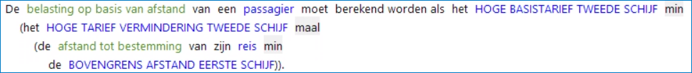
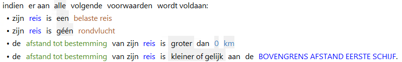
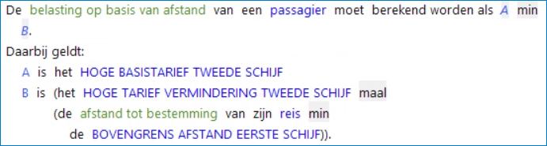

# De opbouw van een RegelSpraak regel

## Naam van een regel

Naamgevingsconventie: de naam van de regel is gelijk aan de naam van het gegevenselement (attribuut of kenmerk) dat een waarde krijgt in de regel, aangevuld met een volgnummer. De naam van een regel moet uniek zijn. In de weergave staat altijd het woord **Regel** voor de naam.

## Geldigheidsperiode van een regelversie

De geldigheidsperiode bepaalt welke regelversie moet worden meegenomen bij de uitvoering van de regels voor een bepaald moment.
Iedere regelversie heeft zijn eigen **geldigheidsperiode**, voorafgegaan door het woord *geldig*:
    * een tweezijdig open interval. In dat geval staat er altijd het woord *altijd* bij vermeld, en is er maar één regelversie;
    * Een éénzijdig open interval, bijvoorbeeld *vanaf 01-01-2021* of *t/m 31-12-2021*;
    * een gesloten interval, bijvoorbeeld *vanaf 01-01-2021 t/m 31-12-2021*;
De geldigheidsperioden van verschillende regelversies van een regel mogen elkaar niet overlappen!
Bij het uitvoeren van RegelSpraak-regels wordt de zogenaamde [rekendatum]() gebruikt om te bepalen welke regelversie moet worden gebruikt.
De granulariteit van de geldigheidsperiode is in te stellen op jaren in plaats van dagen. (bijvoorbeeld *vanaf 2020 t/m 2021*)

## Inhoud van een regelversie

Een regelSpraak-regel bevat altijd hetzelfde basispatroon:

* Resultaatdeel (altijd aanwezig)
* Voorwaardendeel (optioneel)
* Variabelendeel (optioneel)

### Resultaatdeel van regelversie

Iedere regel bevat een *resultaatdeel* met een [actie](Acties.md).
Dit is het deel van de regel dat het resultaat van de regel beschrijft.

In het resultaatdeel kan een aantal [acties](../regels/Acties.md) worden gebruikt.

### Voorwaardendeel van regelversie

Regels kunnen een [**voorwaardendeel**](Voorwaardendeel.md) bevatten.
Dit is het deel van de regel waarin de voorwaarden staan waaraan moet worden voldaan om de actie in het resultaatdeel uit te voeren.
Dit [**voorwaardendeel**](Voorwaardendeel.md) volgt na de **indien**. Bijvoorbeeld:

De voorwaarden kunnen enkelvoudig zijn of samengesteld, en tijdsafhankelijk zijn of -onafhankelijk. Als één van de voorwaarden tijdsafhankelijk is, dan zijn ze dat allemaal.
Tijdsafhankelijke voorwaarden kunnen met of zonder periodeaanduidingen (*van ... tot*) gedefinieerd worden.
Voor meer informatie, zie de pagina over het [**voorwaardendeel**](Voorwaardendeel.md)

**N.B. Als niet aan de voorwaarden wordt voldaan, dan levert de regel geen resultaat op.**

### Variabelendeel van regelversie

Binnen een regel kunnen variabelen worden gedefinieerd die alleen binnen die regel gebruikt worden.
Deze [variabelen](Variabelendeel.md) worden opgenomen in een tekstblok onder de regel dat begint met "Daarbij geldt:". Dat is het laatste deel van een regel in RegelSpraak.

