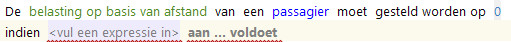
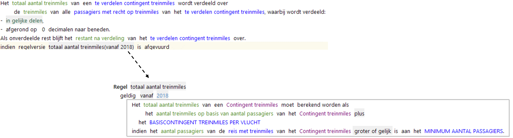
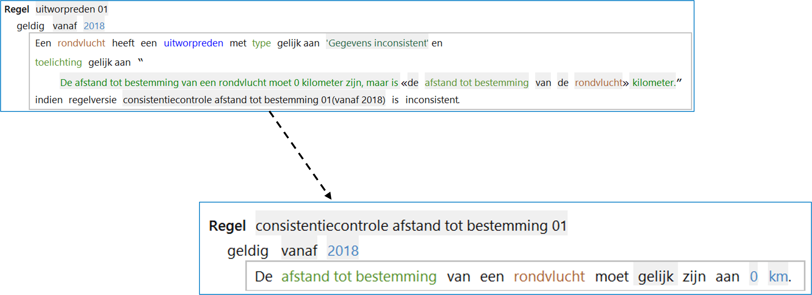

# Voorwaardendeel regel

Dit is het deel van de [regel](RegelSpraak.md) waarin de voorwaarden staan waaraan moet worden voldaan om de [actie](Acties.md) in het resultaatdeel uit te voeren.

## Condities en predicaten

Zowel criteria als voorwaarden worden in RegelSpraak condities genoemd.
Condities worden gespecificeerd met een predicaat.
Een predicaat is een RegelSpraak uitdrukking die iets controleert en *waar* oplevert als de controle slaagt en *onwaar* als de controle niet slaagt.

Het woord "**indien**" wordt voor de onderwerpexpressie gezet als de conditie wordt gebruikt als *voorwaarde*. Bijna alle condities zijn een voorwaarde, behalve in [regels met een criterium](#regels-met-criterium).

Dit is de meest generieke manier om een voorwaardendeel te construeren.
Predicaten hebben een vragende vorm (bv. gelijk is/zijn aan) en een stellende vorm (bv. is/zijn gelijk aan).
De vragende vorm staat vóór een predicaat. De stellende vorm wordt ná het werkwoord ingevoegd.
Enkelvoudige predicaten passen aan het uiteinde van de zin in Regelspraak.
Bij meervoudige predicaten maakt Regelspraak standaard gebruik van een lijstweergave. Zie [samengestelde voorwaarden](Voorwaardendeel_samengesteld.md).

### Regels met criterium

De actie [*consistentieregel*](Actie_Consistentieregel.md) heeft een criterium in plaats van een voorwaarde.
Als de conditie gebruikt wordt als *criterium*, dan wordt het woord "**moet**" tussen de onderwerpexpressie en het predicaat gezet, en wordt de meervoudsvorm (van de vragende vorm) van het predicaat gebruikt.

### Rolcheck

Met een rolcheck kan gecontroleerd worden of een instantie al dan niet een bepaalde [rol](../gegevens/feittype.md) invult.
Hiervoor worden de predicaten "**is/heeft een \<rolnaam\>**" of "**is/heeft geen \<rolnaam\>**" gebruikt waar de te controleren rol achter wordt gezet.

### Kenmerkcheck

Met een kenmerkcheck kan gecontroleerd worden of een instantie al dan niet een bepaald [kenmerk](../gegevens/objecttype.md) heeft.
De predicaten hebben verschillende schrijfwijzen, aangezien een kenmerk bijvoeglijk, bezittelijk of geen van beide kan zijn.

1. Bij bijvoeglijke kenmerken wordt "**is \<kenmerknaam\>**" of "**is niet \<kenmerknaam\>**" gebruikt.
2. Bij bezittelijke kenmerken wordt "**heeft \<kenmerknaam\>** of "**heeft geen \<kenmerknaam\>**" gebruikt.
3. Bij een kenmerk dat niet bijvoeglijk of bezittelijk is, wordt "**is een \<kenmerknaam\>**" of "**is geen \<kenmerknaam\>**" gebruikt.

Het predicaat dient voorafgegaan te worden door een onderwerpexpressie die verwijst naar een objecttype (eventueel via een rol).

### Vergelijkingen

Vergelijkingspredicaten vergelijken de waarde die uit de onderwerpexpressie komt met de waarde die uit een tweede [expressie](Expressies.md) komt.
Die tweede expressie moet hierbij hetzelfde datatype hebben als de onderwerpexpressie.
Indien de waarde gebruik maken van verschillende eenheden uit een [eenheidssysteem](../gegevens/eenheidssysteem.md), dan zal de waarde uit de tweede expressie omgerekend worden naar de eenheid van de eerste expressie voordat de vergelijking plaatsvindt.

"**is gelijk aan**" controleert of de waardes precies aan elkaar gelijk zijn.
"**is ongelijk aan**" heeft als resultaat *waar* als dat niet het geval is.
Beide expressies geven als resultaat *onwaar* als beide kanten een lege waarde hebben!

Voor [datatypes](../gegevens/datatype.md) *numeriek* en *percentage* zijn er predicaten die de grootte van de getallen vergelijken:

* **groter dan**
* **groter of gelijk aan**
* **kleiner dan**
* **kleiner of gelijk aan**

Het resultaat van deze predicaten is altijd *onwaar* als er aan één of beide kanten een lege waarde staat.

Voor het datatype *datum/tijd* zijn er aparte predicaten:

* **later dan**
* **later of gelijk aan**
* **eerder dan**
* **eerder of gelijk aan**

**Let op!** Er is vastgelegd dat *leeg* gelijk aan *leeg* geen geldige vergelijking is, omdat de uitkomst geen echte betekenis heeft. (Dit geldt voor alle predicaten)
Daarom geeft RegelSpraak een foutmelding als dit toch voorkomt.
Voor [Datatypes](../gegevens/datatype.md) *numeriek* en *percentage* werkt dit anders. Om historische redenen wordt een lege waarde in deze datatypes geinterpreteerd als 0.

### Lege waardes

Met de predicaten **leeg zijn / leeg is / is leeg** en **gevuld zijn / gevuld is / is gevuld** kan gecontroleerd worden of een attribuut al dan niet leeg of gevuld is.
Leeg betekent dat er (nog) geen waarde is toegewezen. Gevuld betekent het tegenovergestelde van leeg.

### Tijdsafhankelijke aanvulling op predicaat

Een tijdsafhankelijke conditie betreft een conditie waarbij het resultaat van de conditie tijdsafhankelijk is. Dat wil zeggen dat de conditie waar of onwaar kan zijn op verschillende momenten in de tijd.
Of de conditie tijdsafhankelijk of niet-tijdsafhankelijk is hangt er vanaf of de in de expressie gebruikte gegevens tijdsafhankelijk zijn.
Als één van de gegevens tijdsafhankelijk is, dan zijn de volledige expressie en conditie tijdsafhankelijk.
Predicaten kunnen worden uitgebreid met een check of het betreffende predicaat gedurende een hele periode geldt.
Deze check kan alleen worden uitgevoerd als het onderwerp van het predicaat tijdsafhankelijk is. (Zie [tijdlijnen](../gegevens/tijdlijn.md) en [expressies](Expressies.md) voor [datum](Expressies_Datum.md))
Daarvoor moet de uitdrukking **"gedurende de \<periode\>" / "het gehele \<periode\>"** worden toegevoegd vóór het predicaat. De periode kan bestaan uit jaren of maanden.
De toevoeging betekent dat de controle die het predicaat beschrijft alleen *waar* oplevert als op elk moment in de opgegeven periode de controle *waar* als resultaat heeft.
In een [samengestelde conditie](Voorwaardendeel_samengesteld.md) wordt de uitdrukking "**het is de periode van \<datum\> tot \<datum\>**" gebruikt als zelfstandig predicaat in de lijst van condities.
In deze expressie kunnen ook "**vanaf \<datum\>**" en "**tot en met \<datum\>**" ook gebruikt worden.
Tijdsafhankelijke condities kunnen ook worden gebruikt bij twee specifieke tijdsafhankelijke [expressies](Expressies.md). (Dat zijn "**het totaal van**"  en "**het tijdsevenredig deel**".)

### Regel gevuurd & Regel inconsistent

Regelpredicaten kunnen gebruikt worden om de uitvoering van een regel te controleren.
Er zijn twee soorten controles: controle op consistentie en controle op vuren
Bij deze predicaten is geen onderwerpexpressie nodig maar zal een regelversie opgegeven moeten worden.
Ze controleren de uitvoering van een andere regel.
**\<Regel\> gevuurd is** heeft als resultaat *waar* als de opgegeven versie van een regel tot een toekenning heeft geleid.

**\<Regel\> inconsistent is** heeft als resultaat *waar* als de opgegeven versie van een regel een inconsistentie heeft vastgesteld. Dat moet dan een [consistentieregel](Actie_Consistentieregel.md) zijn.

**Let op:** Het onderwerp van beide regels moet gelijk zijn.

### Getalcontrole

Het predicaat **numeriek zijn met exact ... cijfers** kan alleen gebruikt worden bij een *Tekst* datatype.
Vul in het veld een geheel getal in.
Het predicaat controleert of de tekst ook gelezen kan worden als een getal, oftewel als een numerieke waarde met het opgegeven aantal cijfers.
Het resultaat is *waar* als dat zo is en het aantal cijfers in dat getal overeenkomt met de opgegeven waarde.

### Dagsoortcontrole

Het predicaat **is een \<dagsoort\>** kan alleen gebruikt worden bij een datum/tijd datatype.
Hiermee kan gecontroleerd worden of een bepaalde datum (dag) tot een bepaalde [dagsoort](../gegevens/dagsoort.md) behoort.

### De elfproef

Er bestaat een speciaal predicaat is controleren of een getal aan de elfproef voldoet: **\<reeks van cijfers\> voldoet aan de elfproef**
De hier bedoelde elfproef (er zijn verschillende varianten voor verschillende doeleinden) is een test voor het beoordelen van de geldigheid van een identificatienummer zoals met name het Burgerservicenummer (BSN-nummer).
Hierbij wordt ieder cijfer “gewogen” en bij elkaar opgeteld.
Gewogen betekent dat een cijfer vermenigvuldigd wordt met een afgesproken waarde, afhankelijk van zijn positie in de cijferreeks.
Het toekennen van een weging begint bij het laatste cijfer in de reeks: het laatste cijfer in de reeks (het controlecijfer) krijgt een gewicht van –1, het een-na-laatste cijfer een gewicht van 2, het twee-na-laatste cijfer een gewicht van 3, etc.
Als de gebruikte cijferreeks een geldig BSN-nummer is, moet de som hiervan bij delen door 11 (vandaar de naam “elfproef”) een positief geheel getal opleveren en het getal mag niet uitsluitend uit nullen bestaan.
De genoemde weging van cijfers bij het toepassen van de elfproef impliceert dat slechts enkele datatypen mogelijk zijn: het datatype *Numeriek (geheel getal)* en Tekst zijn toegestaan, met als kanttekening dat bij het datatype Tekst alleen cijfers in de waarde mogen voorkomen (dit kan bijvoorbeeld het geval zijn bij het gebruik van eventuele voor- of achterloopnullen).
