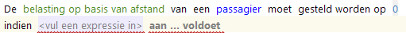
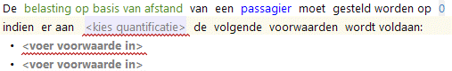
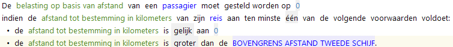
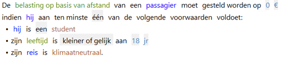
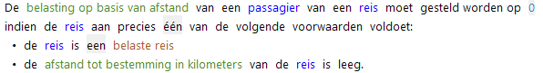
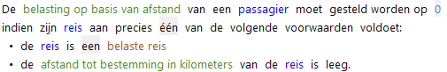
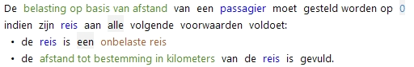
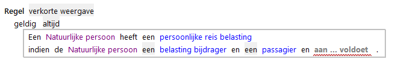
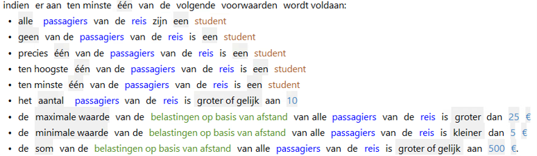
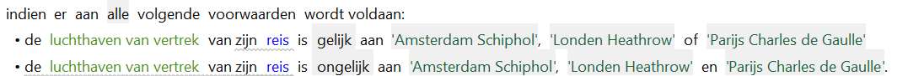

# Enkele en samengestelde condities

Als er meerdere zaken gecontroleerd moeten worden, dan spreken we van een samengestelde conditie.
Om de leesbaarheid en uitdrukking in de natuurlijke taal te bevorderen worden de gebruikte predicaten van samengestelde condities niet (altijd) in een doorlopende zin genoteerd. In RegelSpraak is dat visueel een best groot verschil.
Het woord **indien** wordt voor de onderwerpexpressie gezet als de conditie wordt gebruikt als *voorwaarde*.
Dit is de meest generieke manier om een voorwaardendeel te construeren.
Als de conditie gebruikt wordt als *criterium*, dan wordt het woord **moet** tussen de onderwerpexpressie en het predicaat gezet, en wordt de meervoudsvorm (van de vragende vorm) van het predicaat gebruikt.

## Enkele conditie

Bij een enkele conditie is er slechts &#233;&#233;n predicaat.
Hiervoor wordt de vragende vorm van het predicaat gebruikt.

## Samengestelde conditie

Een samengestelde conditie bestaat uit een lijst met meerdere condities. De lijst met condities wordt gespecificeerd door gebruik te maken van bullets (het symbool **•** ) met een symbool per predicaat.

Dit is een regel met een samengestelde voorwaarde die betrekking heeft op verschillende attributen/rollen/kenmerken/expressies:

Verder moet gespecificeerd worden hoeveel van deze condities waar moeten zijn om de samengestelde conditie waar te laten zijn.
Dit doen we door middel van het toevoegen van een kwantificatie. De volgende kwantificaties kunnen hierbij gebruikt worden:

* **alle** – aan alle condities in de lijst moet voldaan zijn om aan de samengestelde conditie  te voldoen;
* **geen van de** – aan geen van de condities in de lijst mag voldaan zijn om aan de samengestelde conditie te voldoen;
* **ten minste** (*&#233;&#233;n, twee, drie, vier of meer* (genoteerd als getal)) **van de** – aan ten minste het gespecificeerde aantal condities in de lijst moet voldaan zijn om aan de samengestelde conditie te voldoen;
* **ten hoogste** (*&#233;&#233;n, twee, drie, vier of meer* (genoteerd als getal)) **van de** – aan hoogstens het gespecificeerde aantal condities in de lijst mag voldaan zijn om aan de samengestelde conditie te voldoen
* **precies** (*&#233;&#233;n, twee, drie, vier of meer* (genoteerd als getal)) **van de** – aan precies het gespecificeerde getal aan aantal condities in de lijst moet voldaan zijn om aan de samengestelde conditie te voldoen

### Kwantificaties in samengestelde condities

De kwantificatie wordt op de volgende manier gebruikt bij een samengestelde conditie:

1. Bij een samengestelde *voorwaarde* moet de lijst met condities voorafgegaan worden door de woorden **indien er aan** (*getal*) **volgende voorwaarden wordt voldaan:**
2. Bij een samengestelde *voorwaarde* waarbij een *attribuut, kenmerk of rol* van slechts &#233;&#233;n instantie gecontroleerd wordt, kan de onderwerpexpressie die naar die instantie verwijst opgenomen worden in de voorwaarde. De lijst zal dan voorafgegaan worden door de woorden **indien** (*onderwerp expressie*) **aan** (*kwantificatie*) **volgende voorwaarden voldoet:**
3. Bij een samengesteld *criterium* moet de lijst voorafgegaan worden door de woorden **er moet voldaan worden aan** (kwantificatie) **volgende criteria:**
4. Bij een samengesteld *criterium* waarbij een *attribuut, kenmerk of rol* van slechts &#233;&#233;n instantie gecontroleerd wordt, kan de onderwerpexpressie die naar die instantie verwijst opgenomen worden. De lijst zal dan voorafgegaan worden door de woorden (*onderwerp expressie*) **moet voldoen aan** (kwantificatie) **volgende criteria:**

### Voorbeelden van samengestelde condities

Dit is een regel met een samengestelde voorwaarde die controleert of een attribuut aan voorwaarden voldoet.
Aan de waarde van 1 attribuut worden 1 of meer voorwaarden gesteld.

Dit zijn voorbeelden met samengestelde voorwaarden die controleren of de rol van het onderwerp van regel aan voorwaarde voldoet
Aan een rol worden 1 of meer voorwaarden gesteld. Dit kunnen voorwaarden met betrekking tot zowel attributen als kenmerken zijn.

Voorbeelden met voorwaarden aan rol 'reis' in onderwerp van een regel:  

Let op: Omdat het objecttype natuurlijk persoon [**bezield**](../gegevens/objecttype.md) is, zijn de rollen passagier en reis verkort aangeduid met 'hij' en 'zijn'.

Er is ook de optie om voorwaarden te stellen aan andere rollen dan die uit het onderwerp. Aan deze rollen worden dan ook &#233;&#233;n of meer voorwaarden gesteld. Dit kunnen voorwaarden met betrekking tot zowel attributen als kenmerken zijn.

## Verkorte weergave in plaats van lijstweergave

De weergave als lijst is de standaard voor samengestelde condities, maar er bestaat ook een verkorte weergave.
Dat is alleen beschikbaar als alle condities in de lijst verwijzen naar dezelfde instantie (een object of rol).
De condities kunnen dan verbonden worden met **en**. Dat woord moet tussen elke conditie gezet worden.

Omdat het woordt **en** gebruikt wordt, is de betekenis gelijk aan **moet aan alle voorwaarden voldaan**.

## Geneste lijst condities

Binnen &#233;&#233;n item in de lijst van samengestelde condities kan nog een lijst geplaatst worden. Dan staat daar **moet aan ... voorwaarden voldoen**, met daaronder de lijst met bullets en condities. De bullets zien er per niveau anders uit.
Een lijst van condities kan [verkort weergegeven](#verkorte-weergave-in-plaats-van-lijstweergave) worden in de overkoepelende lijst. Het onderwerp van de predicaten moet dan hezelfde zijn.
Voor de condities in de lijst wordt de stellende vorm van het predicaat gebruikt.

## Aggregaties

Er zijn diverse mogelijkheden om een voorwaarde te stellen aan een verzameling voorkomens van een objecttype die middels een rol te bereiken zijn.

## Concatenatie (en/of)

Meerdere "literals" kunnen in een voorwaarde worden samengevoegd.
Een waarde kan gecontroleerd worden op gelijk zijn aan 1 uit een verzameling van waarden. Gebruik daarvoor **Gelijk aan ... of ...**
Het omgekeerde is uitsluiten dat een waarde overeenkomt met 1 uit een verzameling. Gebruik daarvoor **ongelijk aan ... en ...**

