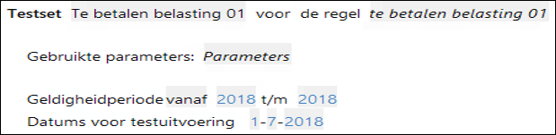
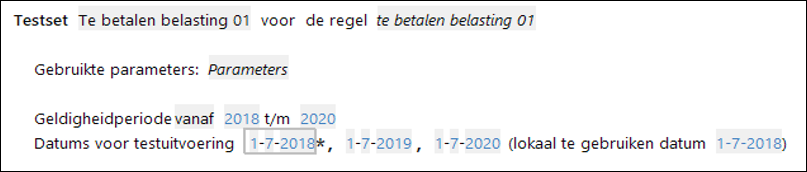
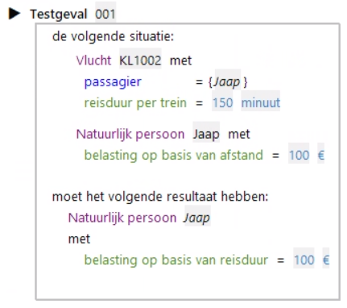
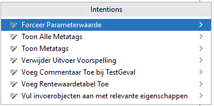
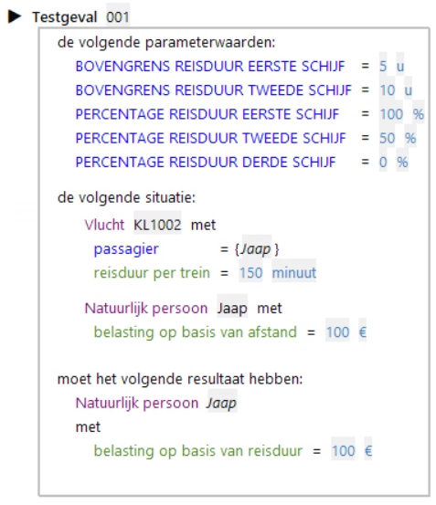
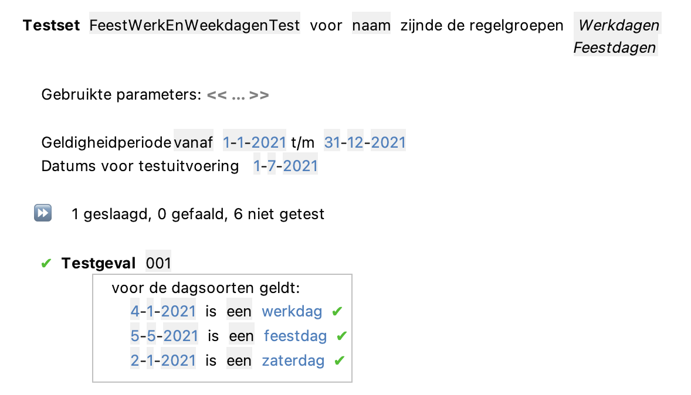
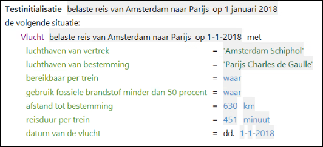
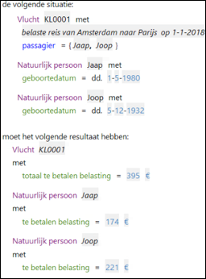
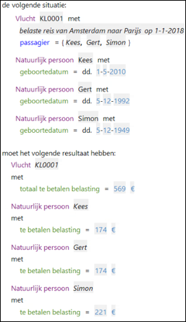

# Testset

In een Testset wordt de scope van de test vastgelegd. De scope geeft aan welke regels betrokken worden in de test. Een testset bevat één of meer **testgevallen**.

Er is specifieke informatie over het [testen van Flows](../testen/TestenFlows.md) en Services. 

## Configuratie testset

De **scope van de test** wordt in de kopregel vastgelegd. In dit voorbeeld is de testscope de regel 'te betalen belasting 01'

Welke **parameterset** wordt gebruikt voor de test, wordt afgeleid van de geldigheidsperiode van de testset en de geldigheid van de parametersets.

Een Testset heeft een **geldigheidsperiode** die aansluit op de geldigheid van regels en parameters in scope van de test. Per jaar moet 1 testdatum worden opgenomen.

Hierboven is een geldigheidsperiode voor de testset van meerdere jaren gebruikt. Voor welk jaar/welke datum de test in ALEF wordt uitgevoerd, wordt vermeld als "lokaal te gebruiken datum" (aangegeven met een sterretje). Tijdens het geautomatiseerd testen in de delivery pipeline worden ook de tests voor de andere datums uitgevoerd.

Tip: Het is beter een aparte testset te maken met een andere geldigheidsperiode en testdatum, omdat je daarin een andere voorspelling van de uitkomsten kunt doen. Van twee tests in dezelfde geldigheidsperiode met dezelfde uitkomst is er immers één overbodig. 

## Testgeval

Een testgeval bevat **testinvoer** en een **testvoorspelling**.

In het voorbeeld hierboven staat de testinvoer onder de tekst 'de volgende situatie:' en de testuitvoer onder de tekst 'moet het volgende resultaat hebben:'

In een testgeval waarin attributen van verschillende objecttypes worden gebruikt, moeten voorkomens/instanties van beide objecttypes in de in- en/of uitvoer worden opgenomen.  
Daarbij moet door middel van een rol de relatie met het andere object worden opgenomen. In het voorbeeld hierboven verwijst de rolnaam 'passagier' in blauw naar de instantie 'Jaap' van objecttype 'Natuurlijk persoon'. 

### Gebruik van parameters in een testgeval

Standaard worden de parameters uit de parametersets gebruikt, die genoemd zijn bovenin de testset onder 'Gebruikte parameters'. Wanneer een parametertoekenning buiten de testscope ligt, moet de testset onafhankelijk zijn van periodieke wijzigingen van parameters. Daarvoor kunnen parameterwaarden worden opgenomen in het individuele testgeval met de intention "Forceer Parameterwaarde".

In het testgeval verschijnt een lijst van parameterwaarden die invoer zijn voor dit specifieke testgeval:

### Dagsoorten testen

Een [dagsoortdefinitie](../regels/Actie_Dagsoortdefinitie.md) bepaalt wanneer een dag van een bepaalde [dagsoort](../gegevens/dagsoort.md) is.
Zo'n definitie kan direct in een testgeval getest worden, zonder dat er eerst een extra regel geschreven hoeft te worden die de dagsoort gebruikt.
In het testgeval wordt dan per datum voorspeld of die datum wel of niet van een bepaalde dagsoort is.

Met de intentie **Voeg Dagsoortvoorspelling Toe** verschijnt in het testgeval het onderdeel **voor de dagsoorten geldt:**.
Daaronder staat per regel een datum, gevolgd door **is een** of **is geen** en de naam van de dagsoort.
Door op **een** te klikken wordt het **geen**, en andersom. Met dezelfde intentie worden extra regels toegevoegd.

In het voorbeeld hierboven wordt voorspeld dat 4-1-2021 een *werkdag* is, dat 5-5-2021 een *feestdag* is en dat 2-1-2021 een *zaterdag* is.
Na het uitvoeren van de test staat achter elke regel of de voorspelling klopt.
Is één van de regels onjuist, dan faalt het hele testgeval.

Een testgeval kan alleen dagsoortregels bevatten. De onderdelen **de volgende situatie:** en **moet het volgende resultaat hebben:** worden dan niet getoond.
Ze kunnen weer worden toegevoegd met de intentie **Voeg Situatie en Resultaat Toe**.
Een testgeval kan ook een situatie en een resultaat combineren met dagsoortregels.
Zo kan bijvoorbeeld bij een regel die een aantal werkdagen bij een datum optelt, in hetzelfde testgeval gecontroleerd worden welke dagen als werkdag meetellen.

Bij het testen van dagsoorten gelden de volgende aandachtspunten:

* **Scope van de testset:** De dagsoortdefinities die nodig zijn, moeten in de [scope van de testset](#configuratie-testset) staan.
  Dat geldt ook voor dagsoorten die een definitie zelf gebruikt.
  Een *werkdag* die gedefinieerd is als "geen zaterdag, geen zondag en geen feestdag" heeft bijvoorbeeld ook de definitie van *feestdag* nodig.
  Ontbreekt een definitie, dan geeft de test de fout "Ongedefiniëerde dagsoort: …".
* **Welke versie van de definitie:** Welke versie van een dagsoortdefinitie gebruikt wordt, hangt af van de testdatum van de testset (de rekendatum),
  niet van de datum in de dagsoortregel.
  De datum in een dagsoortregel mag daarom ook buiten de geldigheidsperiode van de testset liggen, bijvoorbeeld om een feestdag over meerdere jaren te testen.
* **Standaard dagsoorten:** De dagen van de week (*maandag* tot en met *zondag*) zijn altijd beschikbaar en hoeven niet in de scope te staan.
* **Dubbele testgevallen:** Twee testgevallen met precies dezelfde dagsoortregels geven de waarschuwing "Er bestaat al een test met gelijke invoer".

### Testinitialisatie

Wanneer steeds dezelfde invoer wordt gebruikt in testgevallen, kan een set met attribuutwaarden (per objecttype) worden hergebruikt. 

Hieronder wordt een instantie van Vlucht met testinitialisatie geconfigureerd voor hergebruik.

De waarden voor deze instantie van Vlucht kunnen worden opgenomen in meerdere testgevallen door te verwijzen naar de testinitialisatie. 

